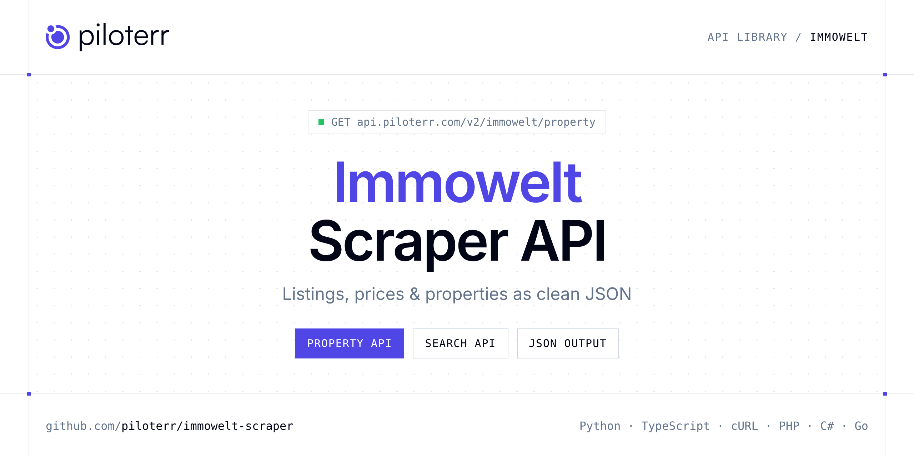

<p align="center">
  <a href="https://www.piloterr.com"></a>
</p>

# Immowelt Scraper API

[](https://discord.gg/CFj3ph8aHU) [](https://app.piloterr.com) [](https://app.piloterr.com/openapi) [](LICENSE)

The **Piloterr Immowelt Scraper API** lets you extract public data from Immowelt as **clean, structured JSON** — no proxies, headless browsers or HTML parsing to maintain. Endpoints available in production:

- **Immowelt Property API** — Extract full property details from an Immowelt listing URL, including price, specs, photo gallery, energy certificate, location, and contact data.
- **Immowelt Search API** — Search Immowelt listings from a search URL and retrieve prices, specs, photos, agency info, and pagination.

Use it for property price monitoring, market analytics, investment sourcing or rental yield models.

| Endpoint | Path | Credits | What you get |
|---|---|---|---|
| [Immowelt Property API](#immowelt-property-api) | `/v2/immowelt/property` | 1 | Extract full property details from an Immowelt listing URL, including price, specs, photo gallery, energy certificate, location, and contact data. |
| [Immowelt Search API](#immowelt-search-api) | `/v2/immowelt/search` | 1 | Search Immowelt listings from a search URL and retrieve prices, specs, photos, agency info, and pagination. |

## Table of contents

- [How it works](#how-it-works)
- [Immowelt Property API](#immowelt-property-api)
- [Immowelt Search API](#immowelt-search-api)
- [Code examples in other languages](#code-examples-in-other-languages)
- [Practical use cases](#practical-use-cases)
- [Why Piloterr?](#why-piloterr)
- [FAQ](#faq)
- [Related scrapers](#related-scrapers)
- [Support](#support)

## How it works

1. **Create a free Piloterr account** and copy your API key from the [dashboard](https://app.piloterr.com).
2. **Send a `GET` (or `POST`) request** to `https://api.piloterr.com/v2/...` with the header `x-api-key: YOUR_API_KEY`.
3. **Receive structured JSON** — Piloterr handles rendering, proxies, retries and parsing.

```bash
export PILOTERR_API_KEY="your-api-key"
pip install requests        # Python
# TypeScript: Node.js 18+ (native fetch), run with `npx tsx file.ts`
```

> Every endpoint accepts both `GET` (query string) and `POST` (JSON body with the same fields).

## Immowelt Property API

Extract full property details from an Immowelt listing URL, including price, specs, photo gallery, energy certificate, location, and contact data.

`GET | POST https://api.piloterr.com/v2/immowelt/property` · **1 credit per request** · [Full reference](https://app.piloterr.com/openapi)

### Request parameters

| Parameter | Type | Required | Description |
|---|---|---|---|
| `query` | string | ✅ | Full Immowelt property detail URL. |

### Python example

```python
import json
import os
import requests

response = requests.get(
    "https://api.piloterr.com/v2/immowelt/property",
    headers={"x-api-key": os.environ["PILOTERR_API_KEY"]},
    params={
        "query": "https://www.immowelt.de/expose/65de0309-bf41-48ce-86fd-6a3441fd0487",
    },
    timeout=120,
)
response.raise_for_status()
data = response.json()

print(json.dumps(data, indent=2, ensure_ascii=False)[:2000])
```

### TypeScript example

```typescript
type ImmoweltProperty = {
  id?: string;
  tags?: {
    is_new?: boolean;
    has3_d_visit?: boolean;
    is_exclusive?: boolean;
    has_brokerage_fee?: boolean;
  };
  brand?: string;
  sections?: {
    key?: {
      keys?: Record<string, unknown>[];
    };
    price?: {
      base?: Record<string, unknown>;
      layout?: string;
      breakdown?: Record<string, unknown>;
      additional?: Record<string, unknown>[];
      components?: Record<string, unknown>[];
    };
    energy?: {
      features?: Record<string, unknown>[];
      has_scales?: boolean;
      certificates?: Record<string, unknown>[];
    };
    gallery?: {
      images?: Record<string, unknown>[];
    };
    features?: {
      details?: Record<string, unknown>;
      preview?: Record<string, unknown>[];
    };
    location?: {
      address?: Record<string, unknown>;
      geometry?: Record<string, unknown>;
      is_address_published?: boolean;
    };
    mortgage?: {
      id?: string;
      zip?: string;
      city?: string;
      prov?: number;
      brand?: string;
      price?: number;
      region?: string;
      country?: string;
      monthly_amount?: number;
      show_rent_label?: boolean;
      federal_state_geo_id?: string;
      show_monthly_rate_label?: boolean;
      formatted_monthly_amount?: string;
    };
    documents?: {
      files?: Record<string, unknown>[];
      display?: boolean;
    };
    hard_facts?: {
      facts?: Record<string, unknown>[];
      price?: Record<string, unknown>;
      title?: string;
      prices?: Record<string, unknown>[];
      keyfacts?: string[];
      location_description?: string;
    };
    partner_ad?: {
      show_partner_ad?: boolean;
    };
    description?: {
      texts?: Record<string, unknown>[];
      headline?: string;
      description?: string;
    };
    enriched_media?: {
      medias?: Record<string, unknown>[];
    };
    area_description?: {
      headline?: string;
      metadata?: Record<string, unknown>;
      description?: string;
    };
    main_description?: {
      headline?: string;
      metadata?: Record<string, unknown>;
      description?: string;
    };
    price_comparison?: {
      is_sale?: boolean;
      legal_text?: string;
      price_per_sqm?: string;
      has_main_price?: boolean;
    };
    seller_lead_link?: Record<string, unknown>;
    extended_info_description?: {
      headline?: string;
      metadata?: Record<string, unknown>;
      description?: string;
    };
  };
  contact_sections?: {
    id?: string;
    brand?: string;
    static?: {
      phone_numbers?: string[];
    };
    sticky?: {
      phone_numbers?: string[];
    };
    provider?: {
      badges?: Record<string, unknown>[];
      address?: string;
      website?: string;
      imprint_url?: string;
      profile_url?: string;
      contact_card?: Record<string, unknown>;
      display_links?: boolean;
      phone_numbers?: string[];
      publisher_type?: string;
      is_private_owner?: boolean;
      intermediary_card?: Record<string, unknown>;
      agency_legal_informations?: unknown[];
    };
    agency_id?: string;
    legacy_id?: string;
    contact_card?: {
      title?: string;
      subtitle?: string;
      agency_logo?: Record<string, unknown>;
      contact_logo?: Record<string, unknown>;
      phone_numbers?: string[];
      is_private_owner?: boolean;
    };
    contact_form?: {
      contact_card?: Record<string, unknown>;
      custom_fields?: Record<string, unknown>;
      subject_label?: string;
      display_owner_flag?: boolean;
      should_send_lead_value?: boolean;
    };
    mobile_phones?: {
      title?: string;
      logo_url?: unknown;
      subtitle?: string;
      phone_numbers?: string[];
      is_private_owner?: boolean;
    };
    confirmation_page?: {
      is_finance_offer_button_enabled?: boolean;
    };
  };
};

const params = new URLSearchParams({
  "query": "https://www.immowelt.de/expose/65de0309-bf41-48ce-86fd-6a3441fd0487",
});

const response = await fetch(`https://api.piloterr.com/v2/immowelt/property?${params}`, {
  headers: { "x-api-key": process.env.PILOTERR_API_KEY! },
});
if (!response.ok) throw new Error(`Piloterr error ${response.status}: ${await response.text()}`);

const data = (await response.json()) as ImmoweltProperty;

console.log(JSON.stringify(data, null, 2).slice(0, 2000));
```

<details>
<summary><b>POST variant</b></summary>

```http
POST https://api.piloterr.com/v2/immowelt/property
x-api-key: YOUR_API_KEY
Content-Type: application/json

{"query": "https://www.immowelt.de/expose/65de0309-bf41-48ce-86fd-6a3441fd0487"}
```
</details>

### Output example

Example response from the API reference, abridged — real values depend on the page you scrape.

```json
{
  "id": "26UBAUCV6EY5",
  "tags": {
    "is_new": true,
    "has3_d_visit": true,
    "is_exclusive": false,
    "has_brokerage_fee": false
  },
  "brand": "immowelt",
  "sections": {
    "key": {
      "keys": [
        {},
        {}
      ]
    },
    "price": {
      "base": {
        "main": {},
        "type": "RENT",
        "details": [
          {},
          {}
        ]
      },
      "layout": "GERMAN_RENT",
      "breakdown": {
        "bar": [
          {},
          {}
        ],
        "total": {},
        "groups": [
          {},
          {}
        ]
      },
      "additional": [
        {}
      ],
      "components": [
        {},
        {}
      ]
    },
    "energy": {
      "features": [
        {},
        {}
      ],
      "has_scales": true,
      "certificates": [
        {}
      ]
    },
    "gallery": {
      "images": [
        {},
        {}
      ]
    },
    "features": {
      "details": {
        "categories": [
          {},
          {}
        ],
        "additional_text": "- Große Balkone und Terrassen in Südausrichtung<br>- Designböden und Parkett mit Fußbodenheizung<br>- Geschmackvolle Dusch- und Wannenbäd…"
      },
      "preview": [
        {},
        {}
      ]
    },
    "location": {
      "address": {
        "city": "Berlin",
        "street": "Friedenauer Höhe 6",
        "country": "DEU",
        "district": "Friedenau",
        "zip_code": "12159"
      },
      "geometry": {
        "type": "Point",
        "coordinates": [
          13.33655452728271,
          52.47751617431641
        ]
      },
      "is_address_published": true
    },
    "mortgage": {
      "id": "7847437c-82b4-4347-a6b6-452ecc09f62d",
      "zip": "12159",
      "city": "Berlin",
      "prov": 0,
      "brand": "immowelt",
      "price": 0,
      "region": "Berlin",
      "country": "DEU",
      "monthly_amount": 0,
      "show_rent_label": true,
      "federal_state_geo_id": "AD04DE11",
      "show_monthly_rate_label": false,
      "formatted_monthly_amount": "0"
    },
    "documents": {
      "files": [
        {}
      ],
      "display": true
    },
    "hard_facts": {
      "facts": [
        {},
        {}
      ],
      "price": {
        "value": "929 €",
        "addition": {},
        "formatted": "929 €",
        "aria_label": "929 €",
        "financial_link": {},
        "additional_information": "Kaltmiete"
      },
      "title": "Studio zur Miete",
      "prices": [
        {},
        {}
      ],
      "keyfacts": [
        "1 Zimmer",
        "29,5 m²"
      ],
      "location_description": "Friedenau ist ein besonders liebenswerter kleiner Ortsteil im Zentrum von Berlin und von den Bezirken Schöneberg, Steglitz und Wilmersdor…"
    },
    "partner_ad": {
      "show_partner_ad": true
    },
    "description": {
      "texts": [
        {},
        {}
      ],
      "headline": "Smyles Living - kompakte Neubauwohnung mit Charme",
      "description": "Das neue Stadtquartier Smyles Berlin im Schöneberger Ortsteil Friedenau verfügt über fünf moderne Gebäude mit insgesamt 537 hellen 1- bis…"
    },
    "enriched_media": {
      "medias": [
        {},
        {}
      ]
    },
    "area_description": {
      "headline": "Lage",
      "metadata": {
        "language": "de"
      },
      "description": "Friedenau ist ein besonders liebenswerter kleiner Ortsteil im Zentrum von Berlin und von den Bezirken Schöneberg, Steglitz und Wilmersdor…"
    },
    "main_description": {
      "headline": "Smyles Living - kompakte Neubauwohnung mit Charme",
      "metadata": {
        "language": "de"
      },
      "description": "Das neue Stadtquartier Smyles Berlin im Schöneberger Ortsteil Friedenau verfügt über fünf moderne Gebäude mit insgesamt 537 hellen 1- bis…"
    },
    "price_comparison": {
      "is_sale": false,
      "legal_text": "Der angegebene Quadratmeterpreis wurde von AVIV Germany automatisch anhand des angegebenen Verkaufspreises und der angegebenen Quadratmet…",
      "price_per_sqm": "31,54",
      "has_main_price": true
    },
    "seller_lead_link": {},
    "extended_info_description": {
      "headline": "Weitere Informationen",
      "metadata": {
        "language": "de"
      },
      "description": "Stichworte\nTiefgarage vorhanden, Anzahl der Badezimmer: 1, Anzahl Balkone: 1, Bundesland: Berlin, 7 Etagen, Wohnungsnr.: WE 01.05.12"
    }
  },
  "contact_sections": {
    "id": "26UBAUCV6EY5",
    "brand": "immowelt",
    "static": {
      "phone_numbers": [
        "030 44353300"
      ]
    },
    "sticky": {
      "phone_numbers": [
        "030 44353300"
      ]
    },
    "provider": {
      "badges": [
        {}
      ],
      "address": "Leipziger Straße 51, 10117 Berlin",
      "website": "https://www.strategis.de/",
      "imprint_url": "https://www.immowelt.de/profil/9e54973f13ffde498cb2190efc8b9890#impressum",
      "profile_url": "example",
      "contact_card": {
        "title": "Stefan Prill",
        "display": true,
        "logo_url": null,
        "subtitle": "Dein Kontakt"
      },
      "display_links": true,
      "phone_numbers": [
        "030 44353300"
      ],
      "publisher_type": "AGENCY",
      "is_private_owner": false,
      "intermediary_card": {
        "title": "STRATEGIS AG",
        "display": true,
        "logo_url": "https://mms.immowelt.de/b/f/2/1/bf213538-3e94-4549-9aef-a9063d983f6f.jpg?ci_seal=3b1d4022350df6c3ca4b9f8fb7eec7acb30acdfe",
        "subtitle": "Gewerblicher Anbieter",
        "logo_href": "https://www.immowelt.de/profil/9e54973f13ffde498cb2190efc8b9890"
      },
      "agency_legal_informations": []
    },
    "agency_id": "1107086",
    "legacy_id": "7847437c-82b4-4347-a6b6-452ecc09f62d",
    "contact_card": {
      "title": "STRATEGIS AG",
      "subtitle": "Stefan Prill",
      "agency_logo": {
        "display": true,
        "logo_url": "https://mms.immowelt.de/b/f/2/1/bf213538-3e94-4549-9aef-a9063d983f6f.jpg?ci_seal=3b1d4022350df6c3ca4b9f8fb7eec7acb30acdfe"
      },
      "contact_logo": {
        "display": false,
        "logo_url": null
      },
      "phone_numbers": [
        "030 44353300"
      ],
      "is_private_owner": false
    },
    "contact_form": {
      "contact_card": {
        "title": "STRATEGIS AG",
        "logo_url": "https://mms.immowelt.de/b/f/2/1/bf213538-3e94-4549-9aef-a9063d983f6f.jpg?ci_seal=3b1d4022350df6c3ca4b9f8fb7eec7acb30acdfe",
        "subtitle": "Stefan Prill",
        "phone_numbers": [
          "030 44353300"
        ],
        "is_private_owner": false
      },
      "custom_fields": {
        "location_enabled": false
      },
      "subject_label": "Deine Nachricht an Stefan Prill",
      "display_owner_flag": true,
      "should_send_lead_value": true
    },
    "mobile_phones": {
      "title": "Stefan Prill",
      "logo_url": null,
      "subtitle": "STRATEGIS AG",
      "phone_numbers": [
        "030 44353300"
      ],
      "is_private_owner": false
    },
    "confirmation_page": {
      "is_finance_offer_button_enabled": false
    }
  }
}
```

### Response fields

| Field | Type | Description |
|---|---|---|
| `id` | string |  |
| `tags` | object |  |
| `tags.is_new` | boolean |  |
| `tags.has3_d_visit` | boolean |  |
| `tags.is_exclusive` | boolean |  |
| `tags.has_brokerage_fee` | boolean |  |
| `brand` | string |  |
| `sections` | object |  |
| `sections.key` | object |  |
| `sections.price` | object |  |
| `sections.energy` | object |  |
| `sections.gallery` | object |  |
| `sections.features` | object |  |
| `sections.location` | object |  |
| `sections.mortgage` | object |  |
| `sections.documents` | object |  |
| `sections.hard_facts` | object |  |
| `sections.partner_ad` | object |  |
| `sections.description` | object |  |
| `sections.enriched_media` | object |  |
| `sections.area_description` | object |  |
| `sections.main_description` | object |  |
| `sections.price_comparison` | object |  |
| `sections.seller_lead_link` | object |  |
| `sections.extended_info_description` | object |  |

## Immowelt Search API

Search Immowelt listings from a search URL and retrieve prices, specs, photos, agency info, and pagination.

`GET | POST https://api.piloterr.com/v2/immowelt/search` · **1 credit per request** · [Full reference](https://app.piloterr.com/openapi)

### Request parameters

| Parameter | Type | Required | Description |
|---|---|---|---|
| `query` | string | ✅ | Full Immowelt search URL. |

### Python example

```python
import json
import os
import requests

response = requests.get(
    "https://api.piloterr.com/v2/immowelt/search",
    headers={"x-api-key": os.environ["PILOTERR_API_KEY"]},
    params={
        "query": "https://www.immowelt.de/suche/mieten/wohnung/deutschland/ad02de1",
    },
    timeout=120,
)
response.raise_for_status()
data = response.json()

print(json.dumps(data, indent=2, ensure_ascii=False)[:2000])
```

### TypeScript example

```typescript
type ImmoweltSearch = {
  results?: {
    id?: string;
    cps?: string;
    url?: string;
    tags?: {
      is_new?: boolean;
      has3_d_visit?: boolean;
      is_exclusive?: boolean;
      has_brokerage_fee?: boolean;
    };
    type?: string;
    brand?: string;
    portal?: string;
    status?: string;
    display?: string;
    gallery?: {
      images?: Record<string, unknown>[];
    };
    location?: {
      address?: Record<string, unknown>;
      is_address_published?: boolean;
    };
    metadata?: {
      id?: string;
      status?: Record<string, unknown>;
      legacy_id?: string;
      update_date?: string;
      creation_date?: string;
    };
    provider?: {
      badge?: Record<string, unknown>;
      address?: string;
      website?: string;
      imprint_url?: string;
      profile_url?: string;
      agency_strip?: Record<string, unknown>;
      contact_card?: Record<string, unknown>;
      display_links?: boolean;
      phone_numbers?: string[];
      publisher_type?: string;
      is_private_owner?: boolean;
      intermediary_card?: Record<string, unknown>;
      agency_legal_informations?: unknown[];
    };
    raw_data?: {
      price?: number;
      nbroom?: number;
      surface?: Record<string, unknown>;
      providercity?: string;
      property_type?: string;
      providerzipcode?: string;
      geo_id_hierarchy?: Record<string, unknown>[];
      distribution_type?: string;
      property_sub_type?: string;
      offerer_marketing_key?: string;
      contact_location_enabled?: boolean;
    };
    tracking?: {
      id?: string;
      city?: string;
      name?: string;
      price?: number;
      region?: string;
      country?: string;
      currency?: string;
      zip_code?: string;
      client_id?: string;
      legacy_id?: string;
      list_name?: string;
      estate_type?: string;
      product_type?: string;
      building_state?: string;
      distribution_type?: string;
      energy_certificate?: string;
    };
    hard_facts?: {
      facts?: Record<string, unknown>[];
      price?: Record<string, unknown>;
      title?: string;
      prices?: Record<string, unknown>[];
      keyfacts?: string[];
    };
    energy_class?: string;
    card_provider?: {
      title?: string;
      logo_url?: unknown;
      subtitle?: string;
      agency_strip?: Record<string, unknown>;
    };
    main_description?: {
      headline?: string;
      metadata?: Record<string, unknown>;
      description?: string;
    };
    has_ai_enrichment?: boolean;
  }[];
  pagination?: {
    next?: number;
    current?: number;
    per_page?: number;
    previous?: unknown;
    total_count?: number;
    total_pages?: number;
    has_next_page?: boolean;
  };
};

const params = new URLSearchParams({
  "query": "https://www.immowelt.de/suche/mieten/wohnung/deutschland/ad02de1",
});

const response = await fetch(`https://api.piloterr.com/v2/immowelt/search?${params}`, {
  headers: { "x-api-key": process.env.PILOTERR_API_KEY! },
});
if (!response.ok) throw new Error(`Piloterr error ${response.status}: ${await response.text()}`);

const data = (await response.json()) as ImmoweltSearch;

console.log(JSON.stringify(data, null, 2).slice(0, 2000));
```

<details>
<summary><b>POST variant</b></summary>

```http
POST https://api.piloterr.com/v2/immowelt/search
x-api-key: YOUR_API_KEY
Content-Type: application/json

{"query": "https://www.immowelt.de/suche/mieten/wohnung/deutschland/ad02de1"}
```
</details>

### Output example

Example response from the API reference, abridged — real values depend on the page you scrape.

```json
{
  "results": [
    {
      "id": "26Y9EVQUEN6D",
      "cps": "26Y9EVQUEN6D",
      "url": "https://www.immowelt.de/expose/b4a08c88-83bf-46b0-a5a5-9a2c91051737",
      "tags": {
        "is_new": false,
        "has3_d_visit": false,
        "is_exclusive": false,
        "has_brokerage_fee": false
      },
      "type": "PROFESSIONAL",
      "brand": "immowelt",
      "portal": "immowelt",
      "status": "Published",
      "display": "classified",
      "gallery": {
        "images": [
          {},
          {}
        ]
      },
      "location": {
        "address": {},
        "is_address_published": true
      },
      "metadata": {
        "id": "26Y9EVQUEN6D",
        "status": {},
        "legacy_id": "b4a08c88-83bf-46b0-a5a5-9a2c91051737",
        "update_date": "2026-05-26T13:20:35.489Z",
        "creation_date": "2026-05-26T13:15:51.95Z"
      },
      "provider": {
        "badge": {},
        "address": "Keplerstr. 21, 72810 Gomaringen",
        "website": "http://www.fvi-gmbh.de/",
        "imprint_url": "https://www.immowelt.de/profil/4ef6f9a229724bda8300b7a39c51e143#impressum",
        "profile_url": "example",
        "agency_strip": {},
        "contact_card": {},
        "display_links": true,
        "phone_numbers": [
          "07072-89 000 64"
        ],
        "publisher_type": "AGENCY",
        "is_private_owner": false,
        "intermediary_card": {},
        "agency_legal_informations": []
      },
      "raw_data": {
        "price": 670,
        "nbroom": 1,
        "surface": {},
        "providercity": "Gomaringen",
        "property_type": "APARTMENT",
        "providerzipcode": "72810",
        "geo_id_hierarchy": [
          {},
          {}
        ],
        "distribution_type": "RENT",
        "property_sub_type": "STUDIO",
        "offerer_marketing_key": "AP50",
        "contact_location_enabled": false
      },
      "tracking": {
        "id": "26Y9EVQUEN6D",
        "city": "Nürtingen",
        "name": "classified",
        "price": 530,
        "region": "Baden-Württemberg",
        "country": "Germany",
        "currency": "EUR",
        "zip_code": "72622",
        "client_id": "1525951",
        "legacy_id": "b4a08c88-83bf-46b0-a5a5-9a2c91051737",
        "list_name": "classified_detail_similars_bottom",
        "estate_type": "av_2",
        "product_type": "standard",
        "building_state": "MINT_CONDITION",
        "distribution_type": "1",
        "energy_certificate": "A"
      },
      "hard_facts": {
        "facts": [
          {},
          {}
        ],
        "price": {},
        "title": "Studio zur Miete",
        "prices": [
          {},
          {}
        ],
        "keyfacts": [
          "1 Zimmer",
          "22 m²"
        ]
      },
      "energy_class": "A",
      "card_provider": {
        "title": "Herr Walter Restle",
        "logo_url": null,
        "subtitle": "Dein Kontakt",
        "agency_strip": {}
      },
      "main_description": {
        "headline": "Gepflegtes, möbliertes Mikroappartement",
        "metadata": {},
        "description": "Objektbeschreibung Diese traumhafte Wohnung ist Teil einer gepflegten, aus insgesamt 66 Wohneinheiten bestehenden Wohnanlage. Raumaufteil…"
      },
      "has_ai_enrichment": true
    },
    {
      "id": "233Z8N1F5GAI",
      "cps": "233Z8N1F5GAI",
      "url": "https://www.immowelt.de/expose/1066aba8-b3c0-43ef-a688-1ce257f0ee11",
      "tags": {
        "is_new": true,
        "has3_d_visit": false,
        "is_exclusive": false,
        "has_brokerage_fee": false
      },
      "type": "PROFESSIONAL",
      "brand": "immowelt",
      "portal": "immowelt",
      "status": "Published",
      "display": "classified",
      "gallery": {
        "images": [
          {},
          {}
        ]
      },
      "location": {
        "address": {},
        "is_address_published": true
      },
      "metadata": {
        "id": "233Z8N1F5GAI",
        "status": {},
        "legacy_id": "1066aba8-b3c0-43ef-a688-1ce257f0ee11",
        "update_date": "2026-06-01T20:02:24.937Z",
        "creation_date": "2014-01-19T16:18:06.623Z"
      },
      "provider": {
        "badge": {},
        "rating": {},
        "address": "Hermann-Ehlers-Straße 3, 49082 Osnabrück",
        "imprint_url": "https://www.immowelt.de/profil/6d1a2b1c9ef247a2afb9097108bc979a#impressum",
        "profile_url": "example",
        "agency_strip": {},
        "contact_card": {},
        "display_links": true,
        "phone_numbers": [
          "1633364213"
        ],
        "publisher_type": "AGENCY",
        "is_private_owner": false,
        "intermediary_card": {},
        "agency_legal_informations": []
      },
      "raw_data": {
        "nbroom": 3,
        "surface": {},
        "providercity": "Osnabrück",
        "property_type": "APARTMENT",
        "providerzipcode": "49082",
        "geo_id_hierarchy": [
          {},
          {}
        ],
        "distribution_type": "RENT",
        "property_sub_type": "TERRACE",
        "offerer_marketing_key": "390 - 1",
        "contact_location_enabled": false
      },
      "tracking": {
        "id": "233Z8N1F5GAI",
        "city": "Osnabrück",
        "name": "classified",
        "region": "Lower Saxony",
        "country": "Germany",
        "currency": "EUR",
        "zip_code": "49082",
        "client_id": "62682",
        "legacy_id": "1066aba8-b3c0-43ef-a688-1ce257f0ee11",
        "list_name": "classified_detail_similars_bottom",
        "estate_type": "av_2",
        "product_type": "standard",
        "distribution_type": "1",
        "energy_certificate": "D"
      },
      "hard_facts": {
        "facts": [
          {},
          {}
        ],
        "price": {},
        "title": "Terrassenwohnung zur Miete",
        "prices": [
          {}
        ],
        "keyfacts": [
          "3 Zimmer",
          "155 m²"
        ],
        "enriched_title": "Terrassenwohnung zur Miete - Seniorenimmobilie"
      },
      "energy_class": "D",
      "card_provider": {
        "title": "Herr Dipl.- Ing. W. Lintker",
        "logo_url": null,
        "subtitle": "Dein Kontakt",
        "agency_strip": {}
      },
      "main_description": {
        "headline": "Repräsentative und außergewöhnliche Wohnung in Osnabrück",
        "metadata": {},
        "description": "Objektbeschreibung Das 2014 fertiggestellte Objekt befindet sich an der Sutthauser Straße, in direkter Nachbarschaft zum denkmalgeschützt…"
      },
      "has_ai_enrichment": true
    }
  ],
  "pagination": {
    "next": 2,
    "current": 1,
    "per_page": 30,
    "previous": null,
    "total_count": 59295,
    "total_pages": 1977,
    "has_next_page": true
  }
}
```

### Response fields

| Field | Type | Description |
|---|---|---|
| `results[]` | object[] |  |
| `results[].id` | string |  |
| `results[].cps` | string |  |
| `results[].url` | string |  |
| `results[].tags` | object |  |
| `results[].type` | string |  |
| `results[].brand` | string |  |
| `results[].portal` | string |  |
| `results[].status` | string |  |
| `results[].display` | string |  |
| `results[].gallery` | object |  |
| `results[].location` | object |  |
| `results[].metadata` | object |  |
| `results[].provider` | object |  |
| `results[].raw_data` | object |  |
| `results[].tracking` | object |  |
| `results[].hard_facts` | object |  |
| `results[].energy_class` | string |  |
| `results[].card_provider` | object |  |
| `results[].main_description` | object |  |
| `results[].has_ai_enrichment` | boolean |  |
| `pagination` | object |  |
| `pagination.next` | integer |  |
| `pagination.current` | integer |  |
| `pagination.per_page` | integer |  |

## Code examples in other languages

Ready-to-run examples live in the [`examples/`](examples) folder. Each one reads your key from the `PILOTERR_API_KEY` environment variable.

| Language | Property | Search |
|---|---|---|
| cURL (Bash) | [`property`](examples/curl/property.sh) | [`search`](examples/curl/search.sh) |
| PHP | [`property`](examples/php/property.php) | [`search`](examples/php/search.php) |
| C# | [`property`](examples/csharp/Property.cs) | [`search`](examples/csharp/Search.cs) |
| Go | [`property`](examples/go/property.go) | [`search`](examples/go/search.go) |
| Java | [`property`](examples/java/PropertyExample.java) | [`search`](examples/java/SearchExample.java) |
| Ruby | [`property`](examples/ruby/property.rb) | [`search`](examples/ruby/search.rb) |
| Node.js | [`property`](examples/nodejs/property.mjs) | [`search`](examples/nodejs/search.mjs) |

## Practical use cases

- **Price monitoring** — Track asking prices and price drops per area.
- **Market analytics** — Measure inventory, days on market and price per m² / sqft.
- **Investment sourcing** — Detect undervalued properties as soon as they are listed.
- **Rental yield models** — Combine sale and rent listings to estimate yields.
- **Proptech products** — Power portals, valuation tools and alerts with structured listings.

## Why Piloterr?

- **No infrastructure** — no proxies, headless browsers or CAPTCHA solving to run yourself.
- **Structured JSON** — stable, documented fields instead of brittle HTML selectors.
- **Pay per request** — transparent credit cost per endpoint, failed requests are retried for you.
- **One API key, hundreds of sources** — Immowelt plus many other e-commerce, search and company data endpoints in the [Piloterr library](https://www.piloterr.com/library).
- **Any language** — plain HTTPS + JSON, with examples for Python, TypeScript, cURL, PHP, C#, Go, Java, Ruby and Node.js.

## FAQ

### Is it legal to scrape Immowelt?

Collecting publicly available data is generally allowed in many jurisdictions, but rules depend on your country, the data you collect and how you use it. Avoid personal data unless you have a lawful basis, respect the website's terms where they apply, and get legal advice for your specific use case. This is not legal advice.

### Do I need proxies or a headless browser?

No. Piloterr handles rendering, proxy rotation and retries on its side. You only send an HTTPS request with your `x-api-key` header and receive JSON.

### How much does a request cost?

Credits per call: `/v2/immowelt/property` **1**, `/v2/immowelt/search` **1**. See the [Piloterr website](https://www.piloterr.com) for plans.

### What data does the Immowelt API return?

Each endpoint returns structured JSON: **Immowelt Property** — `id`, `tags`, `tags.is_new`, `tags.has3_d_visit`, `tags.is_exclusive`, `tags.has_brokerage_fee`; **Immowelt Search** — `results[]`, `results[].id`, `results[].cps`, `results[].url`, `results[].tags`, `results[].type`.

### Which languages are supported?

Any language that can make an HTTP request. This README shows Python and TypeScript; the [`examples/`](examples) folder contains cURL, PHP, C#, Go, Java, Ruby and Node.js.

## Related scrapers

- [Apartments Scraper API](https://github.com/piloterr/apartments-scraper)
- [Argenprop Scraper API](https://github.com/piloterr/argenprop-scraper)
- [Centris Scraper API](https://github.com/piloterr/centris-scraper)
- [Fotocasa Scraper API](https://github.com/piloterr/fotocasa-scraper)
- [Funda Scraper API](https://github.com/piloterr/funda-scraper)
- [Homestra Scraper API](https://github.com/piloterr/homestra-scraper)
- [All Piloterr scrapers on GitHub](https://github.com/piloterr)

## Support

- 💬 Join the [Piloterr Discord](https://discord.gg/CFj3ph8aHU) to ask questions and share what you build.
- 📚 Browse the [API reference (OpenAPI)](https://app.piloterr.com/openapi) and the [Piloterr library](https://www.piloterr.com/library).
- 🔑 [Get your API key](https://app.piloterr.com).

---

<p align="center">
  <a href="https://www.piloterr.com">
    <picture>
      <source media="(prefers-color-scheme: dark)" srcset="images/logo-dark.svg">
      
    </picture>
  </a>
  <br>
  <sub>Built by <a href="https://www.piloterr.com">Piloterr</a> — web scraping APIs for e-commerce, search, real estate and more, one API key.</sub>
</p>

<sub>Immowelt is a trademark of its respective owner. This repository is not affiliated with or endorsed by Immowelt. Examples are released under the MIT license.</sub>
